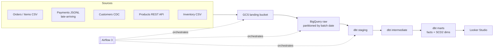

# Retail Analytics Data Platform

End-to-end batch data platform for a fictional toy retailer. Simulated source systems
(CSV files, a REST API and a CDC feed) land in Google Cloud Storage, load into BigQuery,
and are modelled with dbt into analytics-ready marts. Airflow 3 orchestrates the pipeline,
Terraform provisions the infrastructure, and GitHub Actions runs CI/CD.

**Status:** 🚧 In progress. See [Roadmap](#roadmap) and [Build log](#build-log).

## Architecture



## What this project demonstrates

| Capability | Where |
|---|---|
| Incremental loading | _coming in week 2–3_ |
| SCD Type 2 customer history | _coming in week 3_ |
| dbt data quality tests | _coming in week 3_ |
| Airflow retries and backfills | _coming in week 3–4_ |
| BigQuery partitioning and clustering | _coming in week 3_ |
| Logging and failure handling | _coming in week 2–4_ |
| Documentation and CI/CD | _coming in week 1 and 4_ |

## Tech stack

Python 3.11 · uv · ruff · pytest · Airflow 3 · dbt-bigquery · BigQuery · Google Cloud Storage ·
Terraform · GitHub Actions · Looker Studio

## Quickstart

Prerequisites: [uv](https://docs.astral.sh/uv/), Docker, and later a GCP project.

```bash
make setup   # create the virtualenv and install dependencies
make lint    # ruff lint + format check
make test    # run the test suite
```

More steps will appear here as the stack grows.

## Project structure

```
generator/   # simulated source systems (coming soon)
ingestion/   # GCS upload, validation and BigQuery loads (coming soon)
tests/       # pytest suite
```

## Roadmap

- [ ] Week 1: Project scaffold, CI, data generator
  - [x] Python project with uv, ruff, pytest
  - [ ] GitHub Actions CI and pre-commit
  - [ ] Deterministic data generator (customers CDC, products, orders, payments, inventory)
- [ ] Week 2: Products API, GCP + Terraform, Airflow in Docker, ingestion modules
- [ ] Week 3: Ingest DAGs, dbt staging, SCD2 dimensions, order facts
- [ ] Week 4: Remaining marts, dbt in Airflow, backfills, CI/CD, dashboard

## Design decisions

_Key architectural decisions and their trade-offs will be recorded here as they are made._

## Operations

_Runbooks for backfills, failure recovery and adding new sources will be added here._

## Build log

| Date | Progress |
|---|---|
| 2026-11-01 | Scaffolded the Python project: uv, ruff, pytest, Makefile, package layout |
